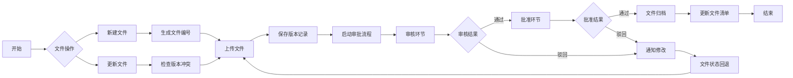

# 开始写工艺文件管理系统

解决工艺文件的流程问题，通过自动化的流程，更新工艺文件清单，简化工艺文件审批流程。

---

### 工作流程

1. 主管工艺员根据模板编写工艺文件
1. 上传工艺文件（是否需要转换为pdf？）
1. 通过组长审核
1. 主管批准
1. 添加签名信息（统一添加 or 流程时分步添加？）
1. 反至资料员处（是否需要？）
1. 确认后制作清单并更新（手动还是自动更新？）（自动的同时增加手动按钮，进行确认）


### 文件存储

工艺文件存储到系统本地，数据库中存相对路径

文件清单进行分步存储，做为链接可打开


---

## 程序设计

人员系统 文件系统 权限系统（？）查找系统（通过文件名，编号，编制人，工序）

1. 人员系统
   - 人员信息
     - 工号（做为外键）
     - 用户名
     - 密码
     - 登录状态（单用户登录使用，查看是否在线？是否需要？上线通过登录确认，如何确认下线状态？cookie存储登录时间）
   - 权限信息
     - 上传（使用异步还是同步？是否需要用户等待上传结果返回？异步通过弹窗还是后台消息？异步是否存在多次点击问题，是否需要限制短时间点击次数）
     - 审核
     - 批准
     - 归档
     - 删除（工艺文件删除是假删除还是真删除，做为状态值删除，或者彻底删除）
     - 更新（更新后是做为同名文件覆盖，或者通过版本号进行区分，若存在多种版本，是否需要受控状态）（更新是只能更新个人文件或是工序文件？存在工艺文件交接问题）
     - 驳回
   - 分工
     - 工序分工
2. 文件系统
   - 工艺文件
     - 名称
     - 版本（需要确定版本号更新的条件，大版本更新前缀，小版本更新后缀）
     - 日期（日期和版本手动填写或是自动反写）
     - 编号
     - 人员
     - 文件内容
     - 工序
   - 文件清单
     - 编号
     - 更新日期
     - 更新方式（手动、自动（每天0点更新，确保编号的唯一性））
3. 权限系统（将工艺文件的编辑方法放着还是存在人员系统中？分成两个系统存在跨表查询，放在人员信息中会将人员表存放过大）

---

## 流程图




---

## 数据库结构设计

1. 人员表

   | 序号 | 字段名 | 字段类型 | 值类型   |
   | :--- | :----- | -------- | :------- |
   | 1    | 序号   | int      | 主键自增 |
   | 2    | 工号   | int32    | 外键唯一 |
   | 3    | 姓名   | char     |          |
   | 4    | 密码   | char     |          |

2. 文件表

   | 序号 | 字段名               | 字段类型 | 值类型    |
   | ---- | -------------------- | -------- | --------- |
   | 1    | 序号                 | int      | 主键自增  |
   | 2    | 文件编号             | char     | 唯一 外键 |
   | 3    | 文件名称             | char     | 唯一      |
   | 4    | 上传人               | char     |           |
   | 5    | 初次上传时间(时间戳) | int      |           |
   | 6    | 最后更新时间(时间戳) | int      |           |
   | 7    | 版本号               | char     |           |
   | 8    | 工序                 | char     |           |
   | 9    | 存储位置             | char     |           |
   | 10   | 文件状态             | int      |           |

3. 权限信息

   | 序号 | 字段名 | 字段类型 | 值类型   |
   | ---- | ------ | -------- | -------- |
   | 1    | 序号   | int      | 主键自增 |
   | 2    | 工号   | int      | 唯一外键 |
   | 3    | 上传   | int      |          |
   | 4    | 审核   | int      |          |
   | 5    | 批准   | int      |          |
   | 6    | 更新   | int      |          |
   | 7    | 删除   | int      |          |

4. 文件清单

   | 序号 | 字段名           | 字段类型 | 值类型   |
   | ---- | ---------------- | -------- | -------- |
   | 1    | 序号             | int      | 主键自增 |
   | 2    | 编号             | char     | 唯一     |
   | 3    | 更新日期(时间戳) | int      |          |

   基于您的需求分析，我来提供一个更完善和实用的系统设计方案：

## 系统架构优化设计

### 1. 人员管理系统
```sql
-- 用户表
CREATE TABLE users (
    id INT PRIMARY KEY AUTO_INCREMENT,
    employee_id VARCHAR(20) UNIQUE NOT NULL,  -- 工号
    username VARCHAR(50) UNIQUE NOT NULL,
    password VARCHAR(255) NOT NULL,          -- 加密存储
    real_name VARCHAR(50) NOT NULL,
    department VARCHAR(100),                 -- 部门
    position VARCHAR(100),                   -- 职位
    status TINYINT DEFAULT 1,               -- 1:正常 0:禁用
    last_login_time DATETIME,               -- 最后登录时间
    login_token VARCHAR(255),               -- 登录令牌
    token_expire_time DATETIME,             -- 令牌过期时间
    created_at TIMESTAMP DEFAULT CURRENT_TIMESTAMP
);

-- 角色表
CREATE TABLE roles (
    id INT PRIMARY KEY AUTO_INCREMENT,
    role_name VARCHAR(50) UNIQUE NOT NULL,   -- 角色名称
    description TEXT,
    created_at TIMESTAMP DEFAULT CURRENT_TIMESTAMP
);

-- 用户角色关联表
CREATE TABLE user_roles (
    id INT PRIMARY KEY AUTO_INCREMENT,
    user_id INT NOT NULL,
    role_id INT NOT NULL,
    FOREIGN KEY (user_id) REFERENCES users(id),
    FOREIGN KEY (role_id) REFERENCES roles(id)
);

-- 权限表（细化权限控制）
CREATE TABLE permissions (
    id INT PRIMARY KEY AUTO_INCREMENT,
    permission_code VARCHAR(50) UNIQUE NOT NULL, -- 权限代码
    permission_name VARCHAR(100) NOT NULL,       -- 权限名称
    description TEXT
);

-- 角色权限关联表
CREATE TABLE role_permissions (
    id INT PRIMARY KEY AUTO_INCREMENT,
    role_id INT NOT NULL,
    permission_id INT NOT NULL,
    FOREIGN KEY (role_id) REFERENCES roles(id),
    FOREIGN KEY (permission_id) REFERENCES permissions(id)
);
```

### 2. 文件管理系统
```sql
-- 文件主表
CREATE TABLE process_files (
    id INT PRIMARY KEY AUTO_INCREMENT,
    file_number VARCHAR(50) UNIQUE NOT NULL,     -- 文件编号
    file_name VARCHAR(255) NOT NULL,            -- 文件名称
    file_type VARCHAR(20),                      -- 文件类型
    version VARCHAR(20) NOT NULL,               -- 版本号
    process_step VARCHAR(100) NOT NULL,         -- 工序
    uploader_id INT NOT NULL,                   -- 上传人ID
    creator_id INT NOT NULL,                    -- 编制人ID
    initial_upload_time DATETIME NOT NULL,      -- 初次上传时间
    last_update_time DATETIME NOT NULL,         -- 最后更新时间
    file_size BIGINT,                           -- 文件大小
    storage_path VARCHAR(500) NOT NULL,         -- 存储路径
    file_status TINYINT DEFAULT 1,             -- 1:草稿 2:待审核 3:待批准 4:已批准 5:已归档 0:已删除
    current_approver_id INT,                    -- 当前审批人
    approval_flow TEXT,                         -- 审批流程记录
    remarks TEXT,                               -- 备注
    FOREIGN KEY (uploader_id) REFERENCES users(id),
    FOREIGN KEY (creator_id) REFERENCES users(id),
    FOREIGN KEY (current_approver_id) REFERENCES users(id)
);

-- 文件版本历史表
CREATE TABLE file_versions (
    id INT PRIMARY KEY AUTO_INCREMENT,
    file_id INT NOT NULL,
    version VARCHAR(20) NOT NULL,
    file_path VARCHAR(500) NOT NULL,
    uploader_id INT NOT NULL,
    upload_time DATETIME NOT NULL,
    change_description TEXT,                    -- 变更说明
    file_size BIGINT,
    FOREIGN KEY (file_id) REFERENCES process_files(id),
    FOREIGN KEY (uploader_id) REFERENCES users(id)
);

-- 文件操作日志表
CREATE TABLE file_operation_logs (
    id INT PRIMARY KEY AUTO_INCREMENT,
    file_id INT NOT NULL,
    operator_id INT NOT NULL,
    operation_type VARCHAR(50) NOT NULL,        -- 上传、更新、审核、批准等
    operation_time DATETIME NOT NULL,
    operation_details TEXT,                     -- 操作详情
    ip_address VARCHAR(45),                     -- 操作IP
    FOREIGN KEY (file_id) REFERENCES process_files(id),
    FOREIGN KEY (operator_id) REFERENCES users(id)
);
```

### 3. 审批流程系统
```sql
-- 审批流程表
CREATE TABLE approval_flows (
    id INT PRIMARY KEY AUTO_INCREMENT,
    file_id INT NOT NULL,
    flow_type VARCHAR(50) NOT NULL,             -- 流程类型
    current_step TINYINT DEFAULT 1,            -- 当前步骤
    status TINYINT DEFAULT 1,                  -- 1:进行中 2:已完成 0:已终止
    initiator_id INT NOT NULL,                 -- 发起人
    created_at DATETIME NOT NULL,
    completed_at DATETIME,
    FOREIGN KEY (file_id) REFERENCES process_files(id),
    FOREIGN KEY (initiator_id) REFERENCES users(id)
);

-- 审批步骤表
CREATE TABLE approval_steps (
    id INT PRIMARY KEY AUTO_INCREMENT,
    flow_id INT NOT NULL,
    step_number TINYINT NOT NULL,              -- 步骤序号
    step_name VARCHAR(100) NOT NULL,           -- 步骤名称
    approver_id INT NOT NULL,                  -- 审批人
    approval_status TINYINT DEFAULT 0,         -- 0:待处理 1:通过 2:驳回
    approval_time DATETIME,
    approval_comment TEXT,                     -- 审批意见
    FOREIGN KEY (flow_id) REFERENCES approval_flows(id),
    FOREIGN KEY (approver_id) REFERENCES users(id)
);
```

## 核心功能实现建议

### 1. 登录状态管理
- 使用JWT token进行身份验证
- token有效期设置（如2小时）
- 支持token刷新机制
- 记录登录日志和安全审计

### 2. 文件上传策略
```javascript
// 前端实现
- 使用分片上传支持大文件
- 显示上传进度条
- 防止重复提交（按钮禁用、请求去重）
- 文件格式和大小验证
```

## 关键设计决策

1. **权限系统**：采用RBAC（基于角色的访问控制）模型，灵活分配权限
2. **文件存储**：真实文件存储在服务器目录，数据库只存元数据
3. **版本控制**：每次更新都保存历史版本，支持版本追溯
4. **审批流程**：可配置的多级审批，支持流程定制
5. **数据安全**：重要操作都有日志记录，支持审计追踪
6. **搜索优化**：建立合适的索引，支持高效的多条件查询

这个设计提供了更好的扩展性和维护性，适合企业级的工艺文件管理系统。